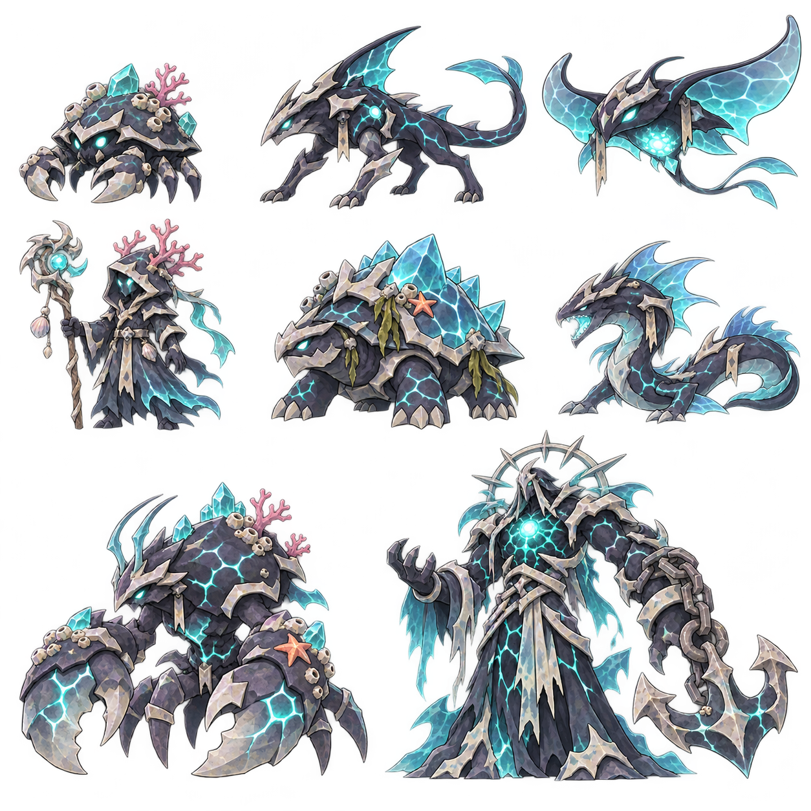
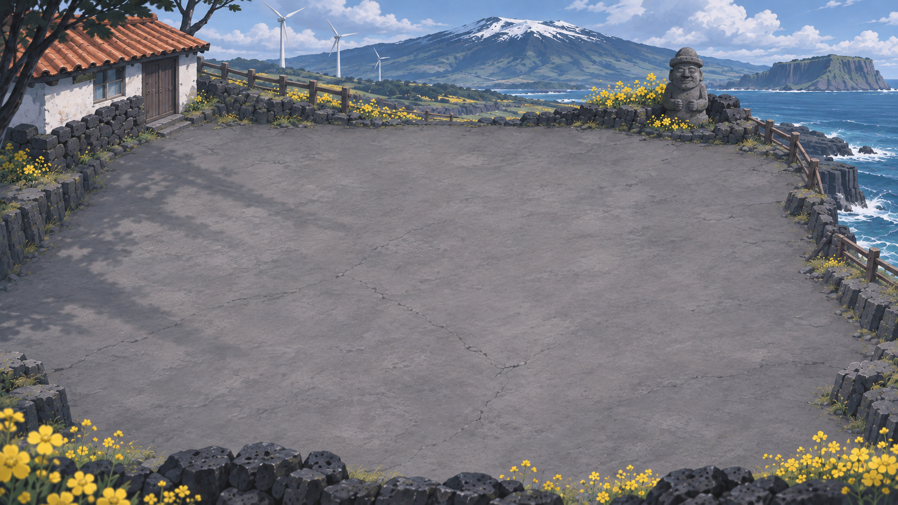
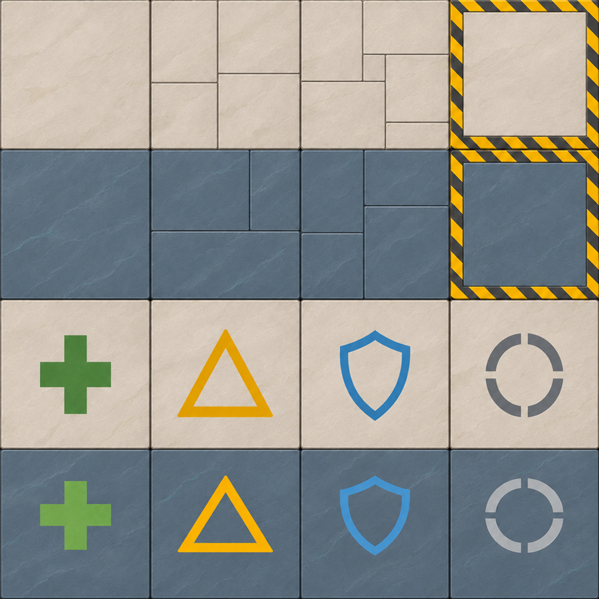
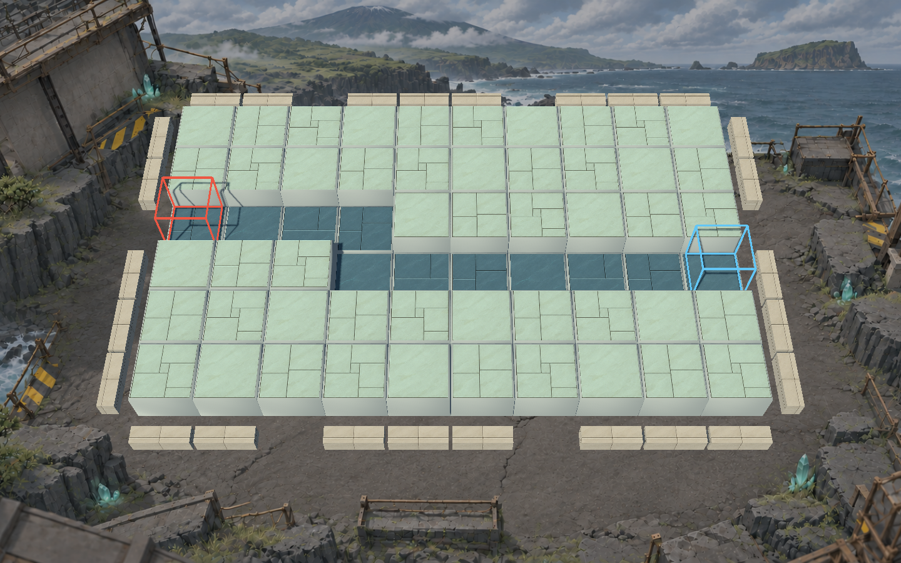
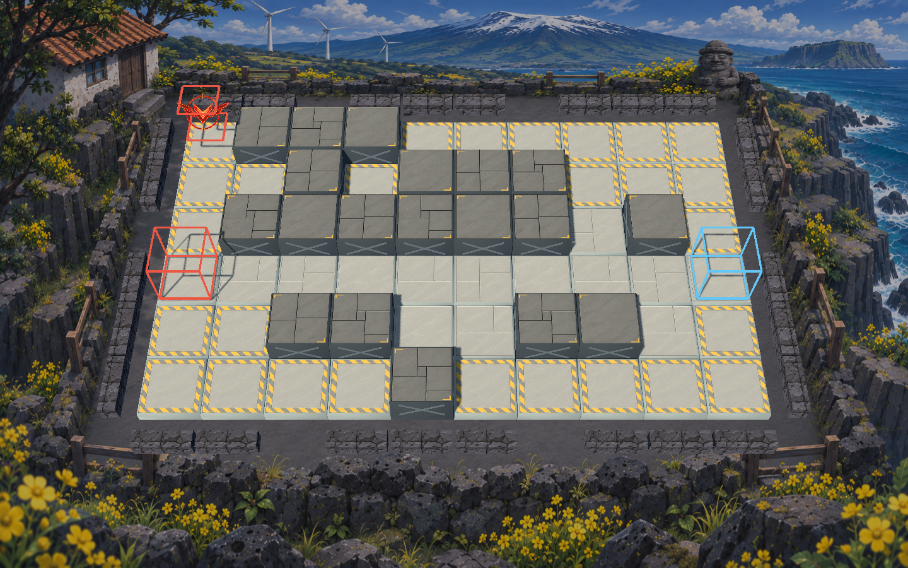
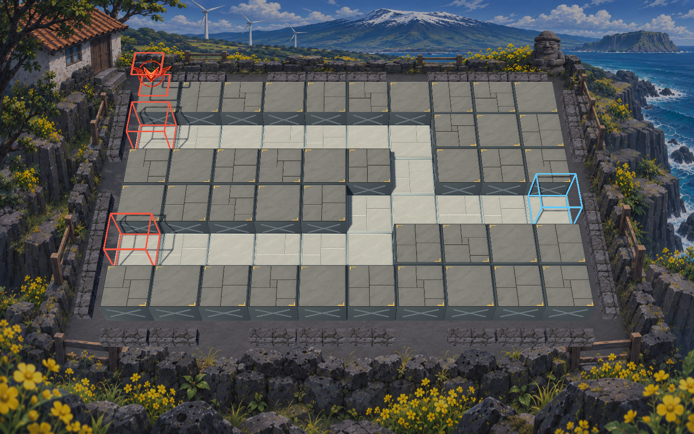
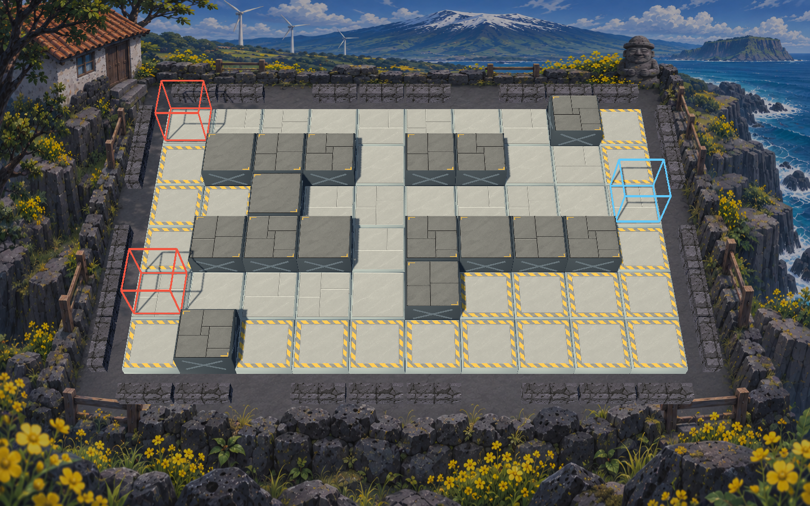
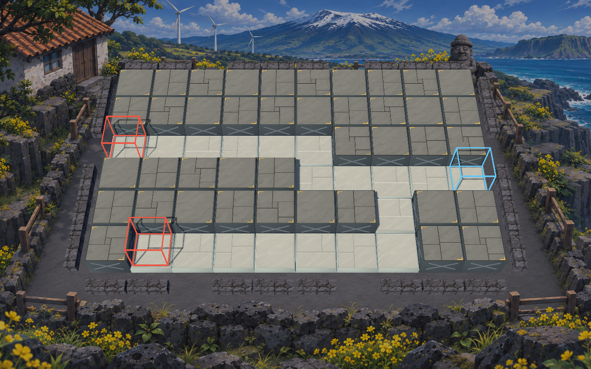

# 第二章工作结果总结

状态：**战斗和剧情均已接入。** 本文记录战斗初版和后续接入进展；战斗难度仍需人工试玩调整。

## 角色

| ID | 角色 | 本次结果 |
| --- | --- | --- |
| character_016 | Tiger | 复用已有攻击图；加入正式角色资源，第一关固定编队可用，战后加入玩家队伍。技能充能 20 秒后手动开启，持续 10 秒，反弹实际损失生命的 30%。 |
| character_017 | Sugar | 复用已有攻击图；加入正式角色资源，第二关固定编队可用，战后加入玩家队伍。每 10 秒储存一层、最多三层；攻击消耗一层，增加 50% 攻击力对应的攻击威力，并回复 2 点部署费用。 |
| character_018 | 前哥 | 已有素材目录迁至编号目录，暂未注册为可出战角色。 |
| character_019 | 冰冰 | 已有素材目录迁至编号目录，暂未注册为可出战角色。 |

小黄在第二章战斗初版中仍处于暂离状态。角色技能数值均为初版，需通过试玩调整。

## 怪物和美术

已根据确认的[八种怪物总览](StarterContent/chapter02_enemy_concept_v2.png)，制作并注册八种海洋异常体：

| ID | 名称 | 初版职责 |
| --- | --- | --- |
| enemy_011 | 潮蚀蟹 | 低生命群怪 |
| enemy_012 | 潜潮猎手 | 高速地面敌人 |
| enemy_013 | 裂潮飞鳐 | 飞行敌人 |
| enemy_014 | 风暴引潮者 | 远程敌人 |
| enemy_015 | 礁甲守卫 | 高防御慢速敌人 |
| enemy_016 | 深潮游鳞 | 高速地面敌人 |
| enemy_017 | 潮蚀巨钳 | 高生命精英 |
| enemy_018 | 深渊缚核者 | 海洋主节点 Boss |

攻击素材为横向四帧透明图，移动使用静态姿态和程序摆动。八种素材的尺寸、透明边界和单元容纳检查已通过；真实窗口中检查了移动方向与攻击关键帧。Art Test 和游戏通过正式内容目录读取素材。

第二章五场战斗共用[战场背景](../content/terrains/terrain_004/backdrop.png)和[地面图集](../content/terrains/terrain_004/atlas.png)，各关单独配置布局、路线和波次。素材原图与提示词保存在 `Human/StarterContent/`；每章共用一张背景和一套图集的要求已写入美术规范。

2026-11-15：按[济州海岸概念图](../devtools/blueprint/images/chapter02_battle_concept.png)更新共用背景、灰石地面、钢架高台和玄武岩围边。三张选关图已重渲染；在实际 Game Test 窗口检查了三关的构图和出入口可读性，三场固定回放均通过。

### 共用战场背景

### 共用地面图集

## 战斗关卡与流程

第二章「海洋」现有五段战前剧情和独立尾声。Tiger 出海寻找船员，探险家 Sugar 在风暴中救起众人，最终两条寻人线在主节点汇合。新增的海上防卫和海岛突围插入旧关卡之间，关卡 ID 保持稳定，显示编号以关卡表行序为准。详见[第二章剧本](Story_02.md)。

| 关卡 | 实现内容 | 固定操作回放结果 |
| --- | --- | --- |
| 2-1 港口防卫 | 单路连续蟹群与重甲敌人，Tiger 首次出场。 | 胜利，剩余 5 点基地生命。 |
| 2-2 海上防卫 | 地面甲板与空中绕行分线。 | 胜利，剩余 5 点基地生命。 |
| 2-3 风暴突围 | 双地面路线与飞行路线，Sugar 负责掌舵，战后加入。 | 胜利，剩余 2 点基地生命。 |
| 2-4 海岛突围 | 步道与沿岸小路，两路在基地前汇合。 | 胜利，剩余 3 点基地生命。 |
| 2-5 海洋主节点 | Boss 主路与侧路绕后。 | 胜利，剩余 5 点基地生命。 |

玩家完成第一章尾声后解锁第二章。二至五关依次考察分线防空、三入口防守、双路汇合和 Boss 与绕后混合压力。小黄救援与主节点复位由最后一战获胜后的尾声演出。

### 2-1 港口防卫

### 2-2 海上防卫

### 2-3 风暴突围

### 2-4 海岛突围

### 2-5 海洋主节点

## 剧情复盘

对照稿为我在收到用户完整对白前写的第二章修订稿。现行剧本采用用户提供的版本，见[第二章剧本](Story_02.md)和提交 `9b9a329`。

- **2-2 合照同时写出了三个人。** 我的稿子写月月拍下两根缠在一起的鱼竿，随后大星想到要给小黄看鱼群。现行版由月月招呼合照，胡胡把合照说成“任务现场记录”，阿五嘴上拿任务说事，最后却说“拍完发我一份”。这几句彼此接得上，交代了胡胡怎么逗队长、阿五怎么给自己留台阶，也让月月有机会约大星下次把小黄拍进去。写闲聊时，先给角色一件能一起做的小事，用各人的反应写关系。
- **2-2 到 2-4 的情绪变化发生在动作里。** 我的稿子用反常的潮向和浮标预告危险。现行版先让胡胡等鱼上钩，再让怪物跃出水面，同一根鱼竿把玩笑变成了险情。上一战损坏动力系统，下一场开头便有了停船救援的理由。到了岛上，众人先为脚踩实地松一口气，再从脚印旁的血迹意识到小黄可能受伤。写战斗前后时，优先找玩家已经看过的动作、道具或上场战斗的后果来触发变化。
- **2-3 Sugar 通过做决定让人记住。** 我的稿子用电台、测潮仪和浮标说明他为什么在附近，但移船后，他主要在交代航向和分工。现行版先让他叫大家抓绳索，再写他跟胡胡对“刺激”的反应，以及主动邀请大星穿越风暴。玩家看到这个人遇险会兴奋、遇见同路人会主动邀约。Tiger 在 2-5 挡到大星身前，也用一个动作交代了他遇险时的立场。设计角色登场时，给他一个体现性格的选择，并让其他人对这个选择有反应。
- **2-4 到 2-6 的寻猫线有连续的情绪变化。** 信号变弱、脚印旁有血迹、确认生命信号、亲眼看到小黄睁眼，每一步都改变大星对它处境的判断。我的岛上段落较多篇幅在交代捆货带、观测站和走哪条路。现行版里，大星看到血迹后先蹲下来沉默，开口想的是“它一定很害怕”，这才有了战前请大家清路的分量。写线索时，除了交代它指向哪儿，也检查它有没有改变角色当下的心情或决定。
- **2-6 先让重逢发生，再交代下一个目标。** 两版都用小黄的动作回应大星。现行版让大星说完“你这个小笨蛋”和“我找了你好久”，小黄蹭了蹭他的手，月月才上前检查。接下来的信息也由不同角色接力交代，月月知道什么能治，阿五找到去哪儿找，Tiger 和 Sugar 各自表态。胡胡的羽绒服笑话放在大家决定出发之后，最后一句再回到大星和小黄。写章节尾声时，给重逢、告别这类时刻留出反应和回应，再让下一阶段的任务进来。

两版各有可以复用的处理。现行版的 Sugar 在风暴中亮相更抓人，旧稿提前用电台解释了他在附近的原因。现行版的血迹让小黄的处境立即变得紧迫，旧稿用左前爪缺一小块解释了大星为什么认得脚印。以后遇到类似场景，可以先写玩家需要看到的变化，再判断哪一条因果或辨认依据必须交代，把它放入人物已经在做的事里。

## 验证结果

- 五战版验证：21 个正式关卡内容校验通过。剧情序列 104 项、玩家流程 185 项通过，覆盖五场战斗续接、尾声、重启读档及编队解锁。用 Story Test 查看了晴海和空岸的新背景，用 Game Test 检查了两个新增战场在 16:9 与 16:10 的布局。
- 战斗规则测试：209 项检查，0 失败，包含反伤、叠层、费用上限与重置。
- 正式章节内容诊断：13 个关卡，0 错误。
- 第二章五关固定操作回放均获胜。
- 第二章真实窗口表现检查：0 失败，覆盖八种怪物的移动朝向和攻击关键帧。
- Art Test 资产检查：52 项检查，0 失败；工作区视觉与导航检查：0 失败。
- 玩家流程：137 项检查，0 失败，包含第一章完成后解锁第二章及重启保留进度。选关检查：40 项检查，0 失败；退出时有 Godot 对象／资源残留提示。

## 未完成与待处理

1. **剧情体验**：已将[第二章剧本](Story_02.md)接入五场战斗和独立尾声；仍需人工体验演出节奏。
2. **实际试玩**：五关已有自动回放，难度和策略空间仍需通章试玩验收。
3. **第一章旧测试**：`chapter_content_test.gd` 共 112 项检查、2 项失败：固定操作回放在 `scene_0104B` 失守，因而未满足胜利与防守时长断言。该夹具仍使用正式角色和敌人数值，需进一步隔离或调整回放。

更详细的关卡和怪物设计见[第二章关卡与美术设计稿](Chapter_02_Design.md)。
