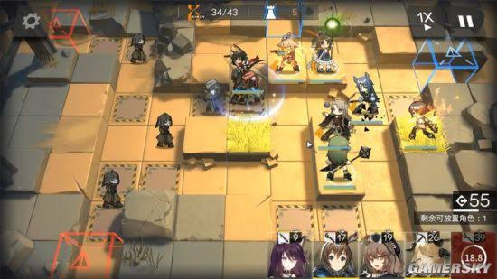

# Star World

## Game Reference

Star World is a tower-defense game. It uses Godot. It is inspired by Arknights（明日方舟）.

## Art Reference

初始资源在：StarterContent目录中

## Philosophy

- 每个模块（美术效果，程序逻辑），都先单独进行开发，通过review再进行集成。减少不必要的耦合，提升开发效率。

## Todo

- [ ] 干员装备
- [ ] 增加被动技能？

【完整来一轮，整理需要改的地方】

## 文案

## 战斗

- 新素材：一个战士类型。一个boss类型。
- 修复素材：重新生成盾牌怪物，左右不对

- 强度调整

- 关卡调整：先优化最终关卡的数值
第三关优化：增强盾牌怪物
第四关：增强怪物伤害
第五关：增多怪物数量

## 剧情

## 关卡

## 音乐
