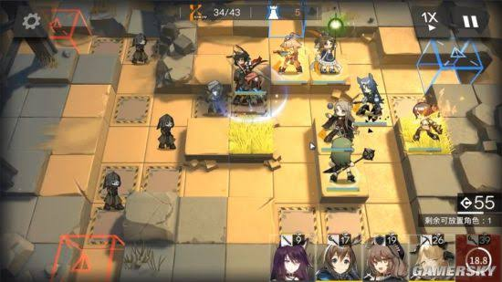

# Star World

## Game Reference

Star World is a tower-defense game. It uses Godot. It is inspired by Arknights（明日方舟）.

## Art Reference

初始资源在：StarterContent目录中

## Philosophy

- 每个模块（美术效果，程序逻辑），都先单独进行开发，通过review再进行集成。减少不必要的耦合，提升开发效率。

## Goal

- 开发者关卡，包含四个子界面：
    - Blueprint：imagegen生成的游戏概念图（参考图，塔防界面）
    - Art Test：只看资产（1）Character（2）Effect（3）Battle（包括UI，但无实机逻辑）
    - Logic Test：只看逻辑（1）极简战斗场景（全用极简占位素材）
    - Game Test：资产+逻辑集成（1）实机战斗场景

初阶段首要目的，是开发一个高效率、低耦合的开发者工具。

让网页上的ai总结明日方舟玩法，再实现。

## Todo

- [ ] Dev Mode
    - [x] Logic Test：验收
    - [x] Game Test：集成最终关卡 Art + Logic。支持tilemap编辑地图
    - [x] Story Test：初版
    - [ ] Game Test：集成剧情
- [ ] Player Mode
    - [ ] 产品化UI（初始界面，存档，关卡选择）
    - [ ] 新手引导
- [ ] Extra
    - [ ] 干员技能树（消耗金币）

改进头顶技能指示